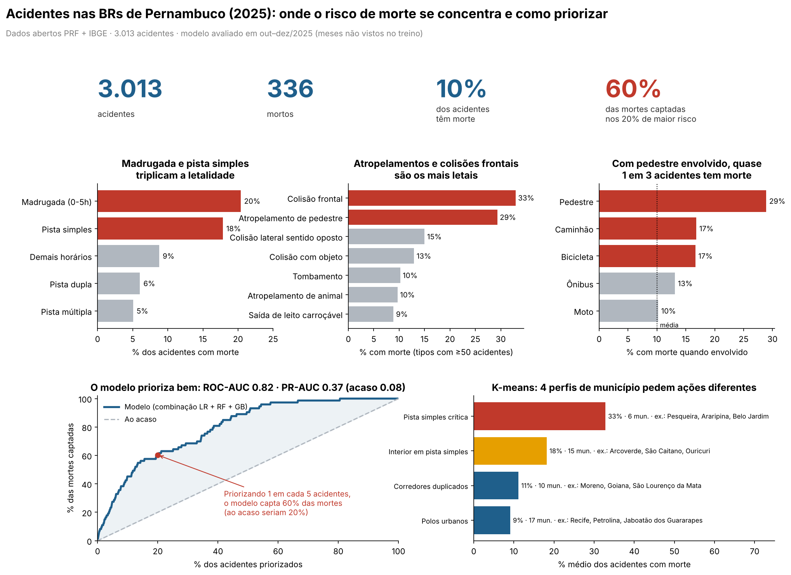
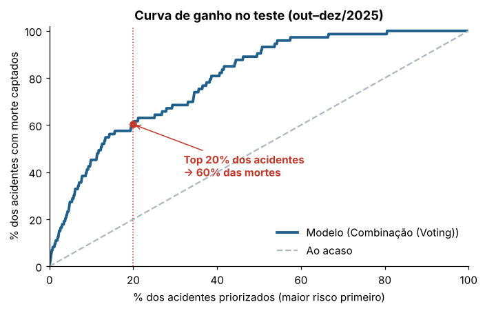
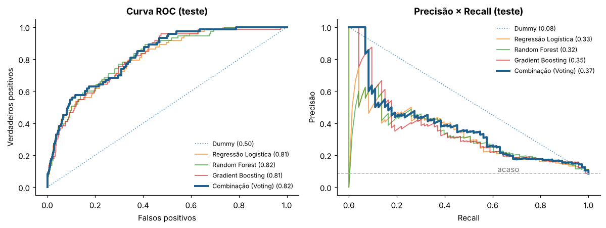
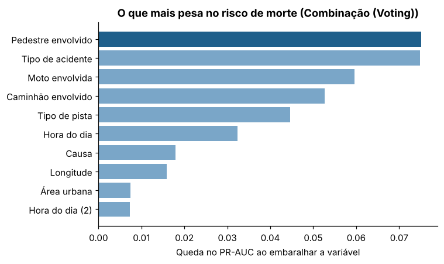
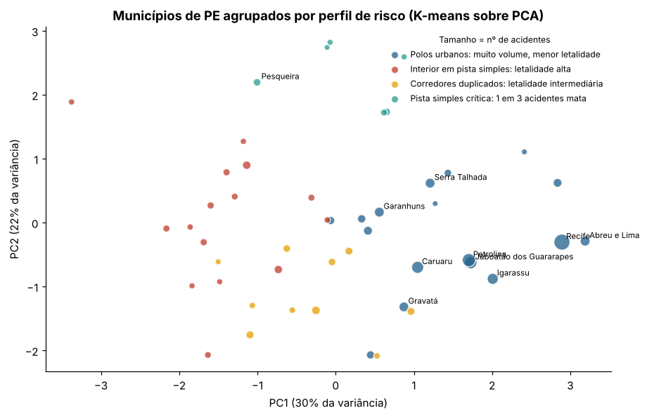

# Acidentes nas rodovias federais de Pernambuco: onde o risco de morte se concentra e como priorizar

**Projeto de Parceria Semantix · EBAC** — Eduardo Costa · [LinkedIn](https://linkedin.com/in/eduardo-costa-408029235) · [GitHub](https://github.com/Edu-Gui)



**Dashboard interativo (Looker Studio):** [abrir o dashboard](https://datastudio.google.com/u/0/reporting/811ceb1a-4f5c-42e8-a8f1-2d85e763b02f/page/p_f5c0dxo08d) · **Relatório de insights:** [PDF](04_relatorio/Relatorio_Insights_PRF_PE_2025.pdf)

---

## Resumo

| | |
| --- | --- |
| **Problema** | Em 2025, 3.013 acidentes nas BRs de PE deixaram 336 mortos. Só 10% dos acidentes têm morte. Quais fatores levam um acidente a ser fatal, e onde agir primeiro? |
| **Dados** | Dados abertos da PRF (acidentes e pessoas envolvidas, 2025) + estimativas de população do IBGE |
| **Modelagem** | Testes de hipóteses · classificação (Logística, Random Forest, Gradient Boosting e uma combinação deles) · segmentação de municípios (PCA + K-means) |
| **Resultado** | O modelo final (combinação) tem **ROC-AUC 0,82** e **PR-AUC 0,37** (o acaso seria 0,08) em meses que ele não viu no treino. **Priorizando 20% dos acidentes, ele capta 60% dos que tiveram morte** |
| **Ação** | Pedestres, colisões frontais, pista simples e madrugada são os fatores de maior risco. Os 6 municípios do perfil "pista simples crítica" têm 1 morte a cada 3 acidentes |

---

## 1. Problema de negócio

Acidente com morte é raro (1 a cada 10), mas é ele que explica quase toda a perda de vidas e os custos sociais mais altos. PRF, DNIT, SAMU e prefeituras têm recursos limitados: viaturas, radares, obras e equipes de resgate. A pergunta de negócio é:

> **Dadas as características de um acidente (local, horário, via, tipo, veículos envolvidos), qual a chance de ele ter morte? E quais trechos e municípios devem receber cada tipo de ação?**

**Por que dados e Machine Learning:** a análise descritiva mostra um fator de cada vez (por exemplo, "madrugada é pior"). Os fatores, porém, se sobrepõem: a madrugada tem mais acidentes em pista simples e com caminhões. Um modelo supervisionado combina todos os fatores ao mesmo tempo e gera uma **pontuação de risco** que pode ser usada para priorizar atendimento e fiscalização. O agrupamento não supervisionado mostra que **municípios diferentes precisam de estratégias diferentes**.

---

## 2. Coleta de dados

| Tabela | Fonte (pública, não confidencial) | Linhas (PE) | Granularidade |
| --- | --- | --- | --- |
| Ocorrências (`datatran2025`) | [PRF – Dados abertos](https://www.gov.br/prf/pt-br/acesso-a-informacao/dados-abertos/dados-abertos-da-prf) | 3.013 | 1 linha por acidente |
| Pessoas (`acidentes2025`) | [PRF – Dados abertos](https://www.gov.br/prf/pt-br/acesso-a-informacao/dados-abertos/dados-abertos-da-prf) | 7.300 (após tratamento) | 1 linha por envolvido |
| População por município | [IBGE – Estimativas 2025](https://www.ibge.gov.br/estatisticas/sociais/populacao/9103-estimativas-de-populacao.html) | 185 | 1 linha por município |

**Fluxo:**

1. **Seleção** ([Etapa 1](Etapa1_Selecao_Dados_PRF_PE.ipynb)): leitura dos arquivos brutos (`01_dados_brutos/`), filtro `uf == 'PE'` e teste dos relacionamentos `ocorrencias.id = pessoas.id` e `municipio → código IBGE`.
2. **Análise exploratória** ([Etapa 2](Etapa2_Analise_Exploratoria_PRF_PE.ipynb)): 9 análises (qualidade, tendência, distribuição, outliers, correlação, causas e letalidade, mapa, perfil das vítimas, trechos críticos).
3. **Tratamento** ([Etapa 3](Etapa3_Tratamento_Dados_PRF_PE.ipynb)): remoção de duplicatas, tratamento de ausentes e valores impossíveis, padronização e 25 colunas derivadas (`03_dados_finais/`, com log em `log_tratamento.csv`).

**Principais achados da EDA**

- BR-101 e BR-232 concentram 65% dos acidentes.
- Madrugada (0h–5h): 20,4% dos acidentes têm morte, contra 8,8% nos demais horários.
- Pista simples: 17,8%, contra 6,0% em pista dupla.
- Colisão frontal (33%) e atropelamento de pedestre (29%) são os tipos mais letais.
- Motos estão em 55% dos acidentes e respondem por 49% dos mortos.

---

## 3. Modelagem

Notebook: [**Etapa4_Modelagem_PRF_PE.ipynb**](Etapa4_Modelagem_PRF_PE.ipynb)

### 3.1 Inferência estatística

Antes de modelar, testamos se as diferenças da EDA podem ser acaso. Usamos o teste qui-quadrado (α = 0,05) e intervalos de confiança de Wilson a 95%.

| Fator | χ² | p-valor | V de Cramér | Conclusão |
| --- | --- | --- | --- | --- |
| Tipo de pista | 109,0 | 2,2e-24 | 0,19 | significativo |
| Fase do dia | 64,9 | 5,2e-14 | 0,15 | significativo |
| Madrugada × demais horários | 41,8 | 1,0e-10 | 0,12 | significativo |
| Fim de semana | 11,0 | 9,3e-04 | 0,06 | significativo (efeito pequeno) |
| Condição meteorológica | 13,3 | 0,065 | 0,07 | **não** significativo |

Madrugada: 20,4% [IC 95%: 16,3%–25,1%] contra 8,8% [7,8%–9,9%]. Pista simples: 17,8% [15,6%–20,3%] contra 6,0% [5,0%–7,3%] em pista dupla. Os intervalos não se sobrepõem.

### 3.2 Classificação: probabilidade de morte em um acidente

- **Alvo:** `com_morte` (1 = pelo menos um morto). Classe positiva com cerca de 10%, ou seja, **dados desbalanceados**.
- **Variáveis (31):** local (BR, km, latitude/longitude, delegacia), tempo (hora em forma cíclica sen/cos, dia da semana, mês, fase do dia), via (tipo de pista, traçado transformado em indicadores, área urbana), clima, tipo e causa do acidente, nº de pessoas e de veículos, e **5 indicadores criados a partir da tabela de pessoas**: moto, pedestre, caminhão, ônibus e bicicleta envolvidos.
- **Sem vazamento de dados:**
  - foram excluídas as variáveis que descrevem o desfecho: `mortos`, `feridos*`, `ilesos`, `classificacao_acidente`, `gravidade`, `estado_fisico` e `vitima_fatal`;
  - o teste é feito com **divisão temporal**: treino jan–set (2.154 acidentes), teste out–dez (859);
  - imputação, padronização e one-hot ficam **dentro do `Pipeline`**, então são ajustadas só no treino de cada dobra.
- **Métricas:** PR-AUC (precisão média, a principal para classe rara), ROC-AUC, e recall/precisão no limiar operacional.
- **Validação:** validação cruzada estratificada com 5 dobras · `RandomizedSearchCV` otimizando PR-AUC · o conjunto de teste foi usado **uma única vez**, e o modelo final foi escolhido pela validação cruzada.

| Modelo | PR-AUC (CV) | ROC-AUC (CV) | **PR-AUC (teste)** | **ROC-AUC (teste)** |
| --- | --- | --- | --- | --- |
| Dummy (linha de base) | 0,106 | 0,500 | 0,085 | 0,500 |
| Regressão Logística (L2, balanceada) | 0,359 | 0,792 | 0,327 | 0,809 |
| Random Forest (balanceada) | 0,373 | 0,771 | 0,324 | 0,816 |
| Gradient Boosting (HistGB) | 0,389 | 0,788 | 0,350 | 0,812 |
| **Combinação – Voting (LR + RF + GB)** | **0,392** | **0,796** | **0,371** | **0,823** |

**Escolha do modelo:** a combinação por média das probabilidades (*soft voting*) foi a melhor na validação cruzada e se confirmou no teste. Ela junta a capacidade das árvores de captar interações com a estabilidade da regressão logística.

**Regra operacional.** O limiar foi definido no treino como os 20% de acidentes de maior risco. No teste:

| | Previsto: sem alerta | Previsto: alerta |
| --- | --- | --- |
| **Real: sem morte** | 661 | 125 |
| **Real: com morte** | 29 | **44** |

- **Recall de 60%:** 44 dos 73 acidentes com morte foram sinalizados, alertando apenas 20% das ocorrências.
- **Precisão de 26%:** é **3,1 vezes** a taxa de acidentes com morte esperada ao acaso (8,5%).
- **Curva de ganho:** os 10% de maior risco concentram 45% dos acidentes com morte; os 30% de maior risco, 68%.

<p align="center"> </p>

**O que mais pesa no risco.** Pela importância por permutação no teste: pedestre envolvido, tipo de acidente, moto envolvida, caminhão envolvido, tipo de pista e hora do dia. Na regressão logística, colisão frontal (razão de chance 1,59), pista simples (1,58), pedestre (1,48) e moto (1,47) são os maiores aumentos de risco.

<p align="center"></p>

### 3.3 Segmentação de municípios: PCA + K-means

Para os 48 municípios com pelo menos 10 acidentes, calculamos 7 indicadores: acidentes por 100 mil habitantes (em log), % com morte, % na madrugada, % em pista simples, % com moto, % com pedestre e % em área urbana. As variáveis foram padronizadas.

- **PCA:** 2 componentes explicam 51% da variância. A PC1 opõe perfil urbano/moto a madrugada/pista simples; a PC2 é praticamente um eixo de letalidade.
- **K-means:** usamos k = 4. A silhueta fica entre 0,18 e 0,20 para k de 4 a 7, e k = 6 ou 7 criam grupos com um só município. A silhueta baixa indica que os perfis variam de forma gradual, e não em grupos bem separados, então eles servem para orientar a ação, não como fronteiras rígidas.

| Perfil | Municípios | Acidentes | Mortos | % com morte | Exemplos | Ação sugerida |
| --- | --- | --- | --- | --- | --- | --- |
| **Pista simples crítica** | 6 | 114 | 40 | **33%** | Pesqueira, Araripina, Belo Jardim, Carpina | duplicação/acostamento, fiscalização de ultrapassagem, faixa central sonorizada |
| **Interior em pista simples** | 15 | 333 | 60 | 18% | Arcoverde, São Caitano, Ouricuri, Cabrobó | fiscalização noturna, sinalização e iluminação |
| **Corredores duplicados** | 10 | 285 | 34 | 11% | Moreno, Goiana, Cabo de Santo Agostinho | controle de velocidade, travessias seguras |
| **Polos urbanos** | 17 | 2.097 | 132 | 9% | Recife, Petrolina, Jaboatão, Caruaru | volume alto: passarelas, campanhas para motociclistas, gestão de tráfego |

<p align="center"></p>

---

## 4. Conclusões

1. **O risco de morte é previsível e está concentrado.** Com informações disponíveis no registro do acidente, o modelo ordena as ocorrências de forma que **1 em cada 5 acidentes reúne 60% dos que tiveram morte**. Isso pode apoiar o despacho de resgate (por exemplo, acionar suporte avançado mais cedo) e o planejamento da fiscalização.
2. **Os fatores de maior risco são acionáveis:** pedestres (passarelas, iluminação, travessias), colisões frontais e pista simples (duplicação, faixa central, fiscalização de ultrapassagem), madrugada (fiscalização noturna, álcool e sono) e motos (campanhas e fiscalização).
3. **Um mesmo plano não serve para todos os municípios.** Os 17 polos urbanos concentram 70% dos acidentes, mas têm letalidade abaixo da média. Poucos municípios do interior em pista simples têm letalidade de 3 a 4 vezes maior. Recursos distribuídos só por volume de acidentes deixariam esses trechos de fora.
4. **A combinação de modelos compensou:** ela ganhou de cada modelo isolado tanto na validação cruzada quanto no teste. O ganho é pequeno, mas foi consistente nas duas avaliações.

**Limitações e próximos passos**

- Há apenas um ano de dados (2025). Incluir 2017–2024 permitiria validar o modelo em anos diferentes e medir sazonalidade.
- O modelo estima a gravidade **dado que o acidente ocorreu**; ele não prevê onde o próximo vai acontecer. Um próximo passo é um modelo de frequência por trecho de 10 km (regressão de Poisson).
- A causa do acidente é registrada pela PRF depois da ocorrência. Para uso em tempo real, ela teria de ser substituída pelas informações do chamado.
- Calibrar as probabilidades e acompanhar o desempenho do modelo mês a mês (*drift*).

---

## 5. Estrutura do repositório

```
├── README.md                              ← esta documentação
├── requirements.txt
├── Etapa1_Selecao_Dados_PRF_PE.ipynb      ← coleta e seleção
├── Etapa2_Analise_Exploratoria_PRF_PE.ipynb
├── Etapa3_Tratamento_Dados_PRF_PE.ipynb
├── Etapa4_Modelagem_PRF_PE.ipynb          ← inferência, classificação, PCA + K-means, painel
├── 01_dados_brutos/                       ← arquivos originais PRF e IBGE
├── 02_dados_pe/                           ← filtrados para PE (saída da Etapa 1)
├── 03_dados_finais/                       ← tratados (saída da Etapa 3, entrada da Etapa 4)
├── 04_relatorio/                          ← relatório de insights (PDF)
└── 05_resultados/
    ├── figuras/                           ← painel, curvas, importância, clusters
    ├── metricas_validacao_cruzada.csv
    ├── metricas_teste.csv
    ├── previsoes_teste.csv                ← probabilidade de morte por acidente (out–dez)
    └── segmentacao_municipios.csv
```

## 6. Como reproduzir

```bash
git clone https://github.com/Edu-Gui/Projeto-Final-PRF_PE.git
cd Projeto-Final-PRF_PE
pip install -r requirements.txt
jupyter notebook Etapa4_Modelagem_PRF_PE.ipynb
```

No **Google Colab**, envie a pasta `03_dados_finais/` e rode as células em ordem. Todas as etapas usam `random_state = 42`. A busca de hiperparâmetros leva cerca de 5 minutos.

**Ferramentas:** Python (pandas, NumPy, SciPy, scikit-learn, matplotlib), Google Colab, Looker Studio e Git/GitHub.
